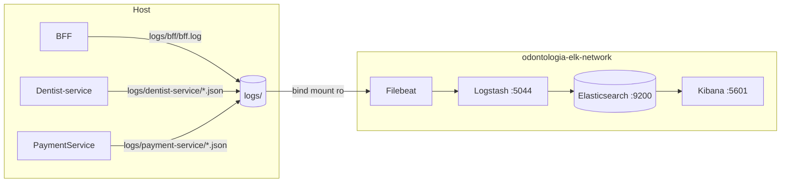

# ELK — logs da Odontologia Integrada

Stack **Elasticsearch + Logstash + Kibana + Filebeat** (8.17.4) para centralizar os logs
estruturados dos serviços. Os serviços .NET e o BFF continuam rodando no host; eles gravam
arquivos JSON em `logs/` na raiz do repositório e o Filebeat (container) lê esses arquivos.



Escopo atual: **somente logs** (sem APM/métricas). Padrão dos campos e catálogo de eventos
em [`docs/logging-standard.md`](docs/logging-standard.md).

## Subir

Pré-requisito: Docker com **~3 GB** livres de memória (ES 1 GB de heap, Logstash 512 MB,
Kibana 1 GB).

```bash
cd elk
cp .env.example .env     # opcional: só para trocar versão, portas ou memória
docker compose up -d
```

Ordem automática: `elasticsearch` → `es-setup` (política ILM e index template) →
`logstash` → `filebeat`; e `kibana` → `kibana-setup` (data view, buscas e dashboard).
A primeira subida leva alguns minutos. Acompanhe com `docker compose ps`.

| Serviço | URL | Observação |
|---|---|---|
| Kibana | http://localhost:5601 | Dashboard **Odonto \| Visão geral de logs** |
| Elasticsearch | http://localhost:9200 | Segurança desativada (dev) |
| Logstash | `logstash:5044` | Apenas na rede interna do compose |

## Onde os serviços gravam

| Serviço | Configuração | Arquivo |
|---|---|---|
| Dentist-service | `Observability:LogDirectory` = `../../logs` (appsettings.Development.json) | `logs/dentist-service/*.json` |
| PaymentService | `Observability:LogDirectory` = `../logs` | `logs/payment-service/*.json` |
| BFF | `LOG_DIR=../logs` (`bff/.env`) | `logs/bff/bff.log` |

Os caminhos são relativos ao diretório do projeto, de onde o serviço é executado
(`dotnet run` / `pnpm run start:dev`). A pasta `logs/` é ignorada pelo Git. Para usar outra
pasta, defina `LOGS_DIR` em `elk/.env` e ajuste a configuração dos serviços.

BFF em Docker (`bff/docker-compose.dev.yml`): monta `../logs` em `/app/logs` e usa
`LOG_DIR=/app/logs`.

## Consultas no Kibana

Em **Discover**, use a data view `odonto-logs` (`logs-*-dev`) ou as buscas salvas
`Odonto | ...`.

| Objetivo | KQL |
|---|---|
| Jornada de uma requisição | `labels.correlation_id : "teste-123"` |
| Agendamentos | `event.action : appointment.*` |
| Mensagens na DLQ | `event.action : consumer.dead_lettered` |
| Falhas do BFF em downstream | `event.action : downstream.*` |
| Erros | `log.level : error` |

Teste rápido de ponta a ponta: envie uma requisição a qualquer endpoint `/api/...` do BFF
com o header `X-Correlation-Id: teste-123` e busque `labels.correlation_id : "teste-123"`.
O `/health` não é indexado.

## Estrutura

| Arquivo | Função |
|---|---|
| `docker-compose.yaml` | Serviços, volumes (`es-data`, `filebeat-data`) e rede `odontologia-elk-network`. |
| `filebeat/filebeat.yml` | Três inputs (bff, dentist-service, payment-service), parser NDJSON. |
| `logstash/pipeline/odonto.conf` | Normaliza `service.name`/`labels.correlation_id`, mascara PII, roteia para `logs-<servico>-dev`. |
| `elasticsearch/` | Política ILM (7 dias), index template e `setup.sh`. |
| `kibana/` | `setup.sh` + `saved-objects.ndjson` (data view, buscas e dashboard). |

## Solução de problemas

- **Elasticsearch reinicia no Linux/WSL2:** `sudo sysctl -w vm.max_map_count=262144`
  (no WSL2: `wsl -d docker-desktop sysctl -w vm.max_map_count=262144`).
- **Não aparece nada no Kibana:** confirme que existem arquivos em `logs/<servico>/`,
  veja `docker compose logs filebeat logstash` e o horário do filtro do Discover
  (padrão: últimas 24 h). O Filebeat varre a pasta a cada 5 s (bind mount no Windows não
  gera eventos de inotify).
- **Reprocessar arquivos já lidos:** `docker compose down` e remover o volume
  `odontologia-elk_filebeat-data`.
- **Zerar tudo:** `docker compose down -v` (apaga índices e offsets).
- **Final de linha:** os `.sh` precisam ter final de linha LF (garantido por `.gitattributes`).
- **Memória insuficiente:** reduza `ES_JAVA_OPTS` e `LS_JAVA_OPTS` em `elk/.env`.

## Produção

Esta configuração é para **desenvolvimento**: segurança do Elasticsearch/Kibana desativada,
sem TLS, nó único e sem réplicas. Em produção: habilitar `xpack.security` com TLS e
usuários/roles, mover a ingestão para agentes por host (ou Filebeat nos nós), revisar
retenção/ILM e backups (snapshots), restringir portas e mascarar dados pessoais na origem.
